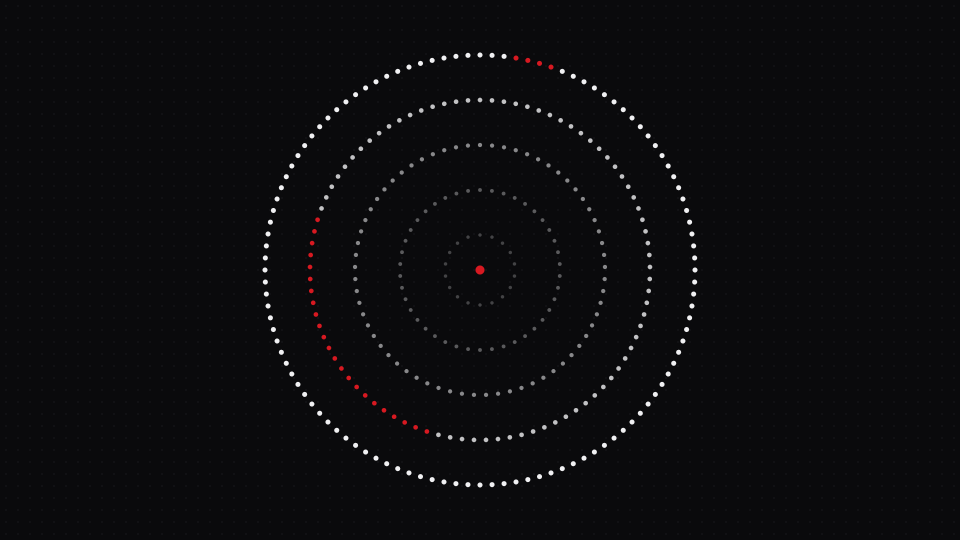
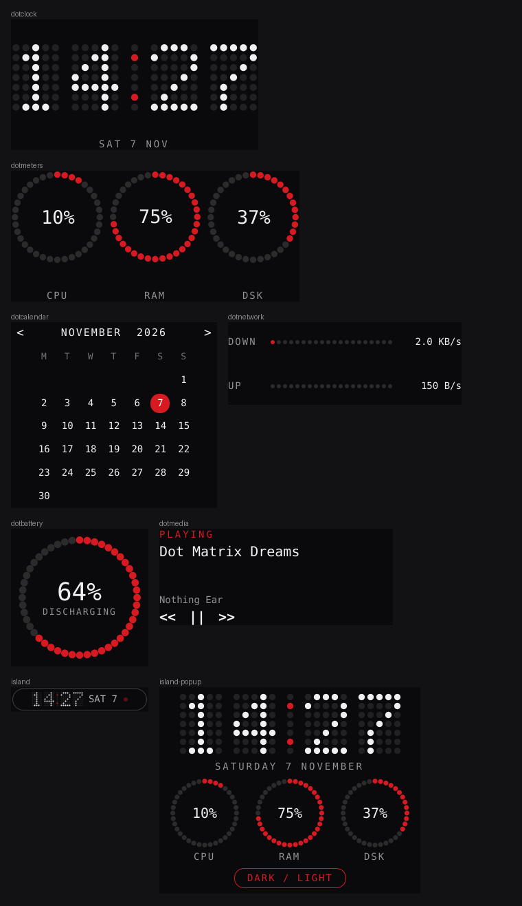

# Glyph Lite

A small, dot-matrix **Nothing-style theme for KDE Plasma 6**: black, white dots and a single red accent.
No daemon, no downloads, no sudo. Built for low-resource machines such as a cloud VM on VNC.




Not affiliated with Nothing Technology. Design language inspired by public Nothing-style KDE projects
(for example Contraill/Nothing-Kde-Theme and glyph-rice); no code from them is included.

## What you get

| Part | Notes |
|---|---|
| Color schemes | `Glyph Lite` and `Glyph Lite Light`, complete (Window, View, Button, Header, Tooltip, Selection, Inactive) |
| Wallpapers | dot-ring and plain dot-grid, dark and light, installed as Plasma wallpaper packages |
| Widgets (Plasma 6) | Dot Clock, Dot Meters, Dot Calendar, Dot Network, Dot Battery, Dot Media (needs `playerctl`) and **Glyph Island**, a pill for a panel with a popup |
| Top bar + dock | `glyph-lite-layout apply`: floating top bar (pager, island, tray) and floating bottom dock from stock Plasma applets; `restore` undoes it |
| Lock screen / GTK | optional `--lockscreen` and `--gtk` |
| Terminals | Konsole profiles, kitty configs, xfce4-terminal presets |
| Launcher | rofi theme, dark and light (`rofi -show drun -theme glyph`) |
| fastfetch | red/white config with a dot-ring logo |
| Mode switch | `glyph-lite-mode dark \| light \| toggle [ring\|plain]` |
| Low-resource tuning | optional `--vnc-tune` / `--no-compositing` |

> **New to Linux or Kali?** Read [START-HERE.md](START-HERE.md) and run `./setup.sh`; it asks simple questions and explains each step.

## Where it works

| Desktop / session | Support |
|---|---|
| KDE Plasma 6 on X11, Wayland or VNC | Full (colors, wallpapers, widgets, terminals, launcher, fastfetch) |
| KDE Plasma 5 | Colors, wallpapers, terminals, launcher, fastfetch (no widgets) |
| XFCE (Kali default) | Wallpaper, xfce4-terminal and kitty colors, launcher, fastfetch |
| GNOME | Wallpaper, dark/light, kitty, launcher, fastfetch |
| Other desktops | Terminals, launcher, fastfetch; wallpapers saved for manual use |

The two widgets are Plasma-only by nature; everything else adapts to what it finds.

## Requirements

- KDE Plasma **6.x** (widgets need `X-Plasma-API-Minimum-Version` 6.0). Written with 6.3 in mind.
- X11 or Wayland. Over TigerVNC you are on X11; transparency and blur are usually unavailable there, so nothing here depends on them.
- Optional: `rofi`, `kitty`, `fastfetch`, `fonts-jetbrains-mono` (`./install.sh --install-deps` runs `apt-get` for the missing ones on Debian/Ubuntu/Kali).

Checked so far: static validation, installer/uninstaller runs against a fake home, and an offscreen render of every widget with stubbed KDE modules (`docs/widgets-preview.png`). Not checked: behavior inside a live Plasma session, including the panel layout script. Please report anything odd.

## Install

```bash
unzip glyph-lite-1.0.0.zip && cd glyph-lite
./setup.sh                      # guided, recommended for beginners
./install.sh --dry-run          # advanced: see what would happen
./install.sh                    # dark mode
./install.sh --vnc-tune         # recommended on a VNC / software-rendered desktop
```

Options: `--light`, `--plain`, `--vnc-tune`, `--no-compositing`, `--no-widgets`, `--install-deps`, `--dry-run`.

Then: right-click the desktop, **Add Widgets**, search "Glyph". Make sure `~/.local/bin` is on your `PATH` for `glyph-lite-mode`.

## Switching dark / light

```bash
glyph-lite-mode toggle
glyph-lite-mode light plain
glyph-lite-mode status
```

It changes the Plasma color scheme, wallpaper, Konsole default profile, and kitty / rofi themes. xfce4-terminal presets are installed but chosen by hand (Preferences > Colors > Presets).

## Make it yours

Everything is generated from one small settings file, `~/.config/glyph-lite/theme.conf`.

```bash
glyph-lite-customize wizard              # guided: accent, wallpaper style, rings, dot size, start mode, corner radius, font
glyph-lite-customize preset amber        # presets: nothing-red, ice, mint, amber, orange, violet, pink, oled, soft
glyph-lite-customize set accent "#FF6A00"
glyph-lite-customize set wallpaper.style spiral    # ring | plain | wave | spiral
glyph-lite-customize set dark.bg "#000000"         # any palette color, dark.* and light.*
glyph-lite-customize apply               # regenerate and install everything
glyph-lite-customize preview             # render wallpaper previews
glyph-lite-customize reset
```

Changing the accent recolors the KDE color scheme (so the widgets, which follow it), Konsole, kitty, xfce4-terminal, rofi, GTK, fastfetch and the wallpapers. Text on the accent color switches between white and near-black automatically so it stays readable. Wallpapers are drawn by a small built-in renderer, so nothing extra needs installing; set `wallpaper.size` (for example `3840x2160`) for other screens.

### Other systems (Windows, macOS, other terminals)

```bash
glyph-lite-customize export ~/glyph-export
```

writes ready-to-use files for Windows Terminal, macOS iTerm2, Alacritty (any OS), VS Code and X resources, plus the wallpapers. The installer itself is Linux only; these exports are the cross-platform part.

## Top bar, island and dock

```bash
glyph-lite-customize layout list          # default, compact, side-dock, classic, bar-only, dock-only, minimal
glyph-lite-customize layout compact       # choose one (saved, not on screen yet)
glyph-lite-layout apply                   # put it on screen (first time)
glyph-lite-layout reapply                 # after changing the layout again
glyph-lite-layout restore                 # put your previous panels back
```

It adds floating panels and leaves your existing ones alone; delete the old panels by hand if you want only the new ones. The dock is Plasma's own Icons-Only Task Manager, and the bar uses the pager, Glyph Island and the system tray.

Everything about the layout is a setting you can change one by one:

```bash
glyph-lite-customize set layout.bar_height 28
glyph-lite-customize set layout.dock_height 60
glyph-lite-customize set layout.dock_position left        # top | bottom | left | right
glyph-lite-customize set layout.bar_position bottom       # top | bottom
glyph-lite-customize set layout.floating false
glyph-lite-customize set layout.length fill               # fit | fill
glyph-lite-customize set layout.bar_items "launcher,pager,spacer,island,spacer,clock,tray"
glyph-lite-customize set layout.dock_items "tasks"
glyph-lite-customize set layout.bar true                  # or false to skip the bar (same for dock)
glyph-lite-customize apply && glyph-lite-layout reapply
```

Items you can use: `pager spacer island tray tasks launcher clock desktop separator`. Panel options such as floating and fit-to-content differ between Plasma versions; any option your Plasma does not know is skipped.

**Island, clock and calendar settings:** right-click the widget and choose Configure. The island has 12/24-hour time, show the date, date style, show the CPU dot and show the outline; the Dot Clock has 12/24-hour and show date; the Dot Calendar chooses the first day of the week.

## How it compares

Glyph Lite is the lightweight option. Bigger projects (Contraill's Nothing KDE theme, glyph-rice, nothing-os-desktop) ship custom shells, lock screens, boot splashes and login screens, and are mostly tied to newer Plasma or to Hyprland. Glyph Lite does not ship a boot splash, SDDM login theme or notification skin, and its island is a panel widget, not a full shell. In return it runs on Plasma 6.x including 6.3, on X11 and Wayland, and adapts to XFCE and GNOME.

## Low-resource tuning (VNC)

`--vnc-tune` sets: animation speed to instant, blur and contrast effects off, Baloo file indexing off.
`--no-compositing` additionally turns KWin compositing off (the lightest option). Every key it touches is recorded and put back by `uninstall.sh`.

## Uninstall

```bash
./uninstall.sh
```

Restores backed-up files (kitty.conf, fastfetch config, ...), removes what was added, resets each KDE setting it changed, and re-applies your previous color scheme. Your wallpaper is not restored automatically.

## Development

```bash
python3 tools/make_assets.py   # regenerate palettes, wallpapers, logo (needs cairosvg for PNGs)
./validate.sh                  # static checks (+ shellcheck / qmllint / desktop-file-validate if installed)
tools/package.sh               # dist/glyph-lite-<version>.zip + sha256
```

The palette lives in one place (`tools/make_assets.py`); every theme file is generated from it.

## Troubleshooting

- **Widgets missing:** run `kbuildsycoca6`, then restart the shell with `kquitapp6 plasmashell; kstart plasmashell`.
- **Colors look half-applied:** log out and in once.
- **rofi highlight not red:** make sure `~/.config/rofi/glyph.rasi` exists (run `glyph-lite-mode dark`).
- **fastfetch logo not shown:** needs fastfetch 2.x; check `source` in `~/.config/fastfetch/config.jsonc`.

## License

MIT. See `LICENSE`.
